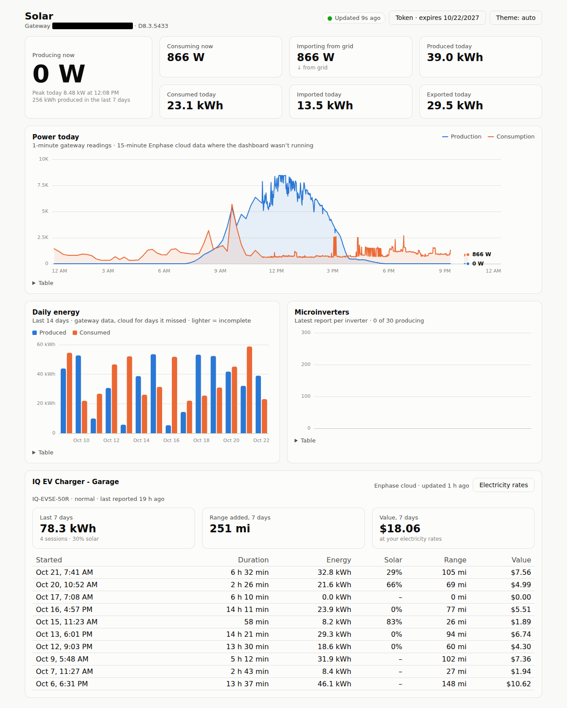

# Enphase Dashboard

A self-hosted dashboard for Enphase solar systems. It reads your **IQ Gateway (Envoy)** directly on your
local network, and can optionally use the **Enphase cloud API** to fill in history and show
**IQ EV Charger** sessions.

- Live production, consumption, and grid import/export (5-second updates)
- Today's power curve and daily energy totals for the last 14 days
- Output for each microinverter
- EV charger sessions: energy, range added, how much came from solar, and the value at your electricity rates
- Gateway token creation and renewal built in (Enlighten sign-in, or paste a token)
- Light and dark mode (automatic, or chosen with the theme button), works on phones, and every chart has a table view

Not affiliated with or endorsed by Enphase Energy.

<picture>
  <source media="(prefers-color-scheme: dark)" srcset="docs/screenshot-dark.png">
  
</picture>

## How it works

```
browser ──► dashboard server ──► IQ Gateway (https, local network)
                              └──► Enphase cloud API (optional)
```

Browsers can't call the gateway directly, because it uses a self-signed certificate and has no CORS.
So a small server does that work. It's a single self-contained Go binary with the React UI built in, and it polls `/ivp/meters/readings` every 5 s, records one point per
minute, and works out daily totals from the meters' lifetime counters. On some firmware versions the
`whToday` fields in `production.json` are broken, which is why it doesn't use them. Everything it
stores goes in `data/`.

What you need:
- IQ Gateway firmware 7.x or 8.x with token authentication.
- Consumption CTs, for consumption and import/export figures. Without them you only get production.

## Quick start (Docker)

1. Copy `compose.yaml` and `.env.example` into a folder, rename `.env.example` to `.env`, and set at
   least `ENVOY_HOST` (the gateway's **IP address**; `envoy.local` usually doesn't resolve inside
   Docker) and `TZ`.
2. Run `docker compose up -d`.
3. Open `http://<host>:3001`, then create or paste a gateway token (see [Gateway token](#gateway-token)).

The image `ghcr.io/cdonner/enphase-dashboard` is published for `amd64`, `arm64` and 32-bit `arm/v7`.
Docker picks the right one automatically. Data, tokens, and credentials are kept in the `solar-data`
volume, so back it up if you care about the history.

## Installing on a NAS

A NAS is a good home for the dashboard: it's always on and on the same network as the gateway. The
dashboard needs very little (under 100 MB of RAM), so even older ARM models run it fine.

### 1. Create a data folder

Make a folder on a share for the dashboard's data, for example `Container/solar-dashboard/data`.
On QNAP this folder is `/share/Container/solar-dashboard/data`; on Synology it's
`/volume1/docker/solar-dashboard/data`. Store the data here rather than in a Docker volume, so you
can back it up and copy files in and out over SMB.

### 2. Create the container

**QNAP (Container Station):** go to *Applications → Create*, enter a name, and paste the YAML below.
**Synology (Container Manager):** go to *Project → Create*, choose the folder from step 1's parent as
the path, and paste the same YAML.

```yaml
services:
  solar-dashboard:
    image: ghcr.io/cdonner/enphase-dashboard:latest
    container_name: solar-dashboard
    restart: unless-stopped
    ports:
      - "3001:3001"
    environment:
      ENVOY_HOST: 192.168.1.50   # your gateway's IP address
      TZ: America/New_York       # your time zone
      DASHBOARD_PASSWORD: ""     # recommended: anyone on your network can reach the NAS
      # Optional Enphase cloud features (see below):
      # ENPHASE_API_KEY: ""
      # ENPHASE_CLIENT_ID: ""
      # ENPHASE_CLIENT_SECRET: ""
    volumes:
      - /share/Container/solar-dashboard/data:/app/data   # Synology: /volume1/docker/solar-dashboard/data
```

Put the values directly in the YAML, because the NAS apps don't read a `.env` file. Then open
`http://<nas-ip>:3001`.

### 3. Moving from another machine (optional)

If the dashboard has already been running somewhere else, stop it there, then copy the contents of
its `data/` folder into the NAS data folder before starting the container. That brings over the
gateway token, the cloud connection, and the recorded history.

Never run two copies against the same Enphase cloud connection at once. Each refresh issues a new
token and invalidates the previous one, so one of the copies will lose access. A copy without cloud
credentials is fine, because it only polls the gateway.

### 4. Updating

Every push to `main` publishes a new `latest` image. NAS container apps usually keep using the copy
they already downloaded, even if you delete and recreate the application, so pull the new image
explicitly. Over SSH, this pulls it and replaces the container in one go:

```bash
DIR=$(docker inspect solar-dashboard --format '{{ index .Config.Labels "com.docker.compose.project.working_dir" }}')
cd "$DIR" && docker compose pull && docker compose up -d
```

(Older Container Station versions use `docker-compose` instead of `docker compose`.) Your data folder
is kept. To update automatically, run the same command from cron, e.g. nightly.

### NAS notes

- **Gateway address:** use the IP address. `envoy.local` usually doesn't resolve inside containers.
  Giving the gateway a fixed address (a DHCP reservation in your router) stops it from moving.
- **ARM models and "page size" warnings:** some 32-bit ARM NAS units, such as the QNAP TS-431X
  series, run kernels with 32 KB memory pages. Ordinary Linux images (Debian, Alpine, Node) can't
  start on them, and QNAP shows a page-size warning when you install any container. This image is
  just one static Go binary with no system libraries, so it isn't affected and the warning can be
  ignored.
- **No Container Station?** Run the binary directly instead (see below).
- **Port in use:** change the left side of the mapping, for example `"8085:3001"`.

## Running without Docker

Each [release](https://github.com/cdonner/enphase-dashboard/releases) includes standalone binaries
for Linux (`amd64`, `arm64`, `armv7`), macOS, and Windows. A binary has the UI built in, so there's
nothing else to install:

```bash
chmod +x enphase-dashboard-linux-armv7
ENVOY_HOST=192.168.1.50 TZ=America/New_York HOST=0.0.0.0 ./enphase-dashboard-linux-armv7
```

It stores its data in `./data` (change this with `DATA_DIR`) and also reads settings from a `.env`
file in the current directory. To start it at boot, use a systemd unit on Linux, or the NAS's
autorun mechanism (QNAP: `autorun.sh`).

## Building from source

Requires Node 22+ and Go 1.26+.

```bash
npm install
cp .env.example .env   # set ENVOY_HOST and TZ
npm start              # builds the UI and the server binary, then serves on http://127.0.0.1:3001
```

For development, `npm run dev` runs Vite on http://localhost:5173 with hot reload, and proxies `/api`
to the Go server.

## Configuration

| Variable | Default | |
|---|---|---|
| `ENVOY_HOST` | `envoy.local` | Gateway IP or hostname |
| `TZ` | system | Time zone; daily totals reset at local midnight |
| `PORT` | `3001` | |
| `HOST` | `127.0.0.1` (`0.0.0.0` in Docker) | Interface to listen on |
| `DATA_DIR` | `./data` (`/app/data` in Docker) | Where tokens and history are stored |
| `POLL_MS` | `5000` | Gateway polling interval |
| `DASHBOARD_PASSWORD` | – | If set, the dashboard asks for this password (HTTP basic auth, any username) |
| `ENPHASE_API_KEY`, `ENPHASE_CLIENT_ID`, `ENPHASE_CLIENT_SECRET` | – | Enables the [Enphase cloud](#enphase-cloud-optional) features |

## Gateway token

Gateway firmware 7 and later needs a JWT from Enphase. On first start the dashboard shows a setup
panel with two ways to get one:

- **Sign in with Enlighten.** Enter your Enlighten email and password. The server requests a token
  for your gateway and checks that the gateway accepts it. If you tick *Remember credentials*, it
  renews the token by itself before it expires. Homeowner tokens last about a year; installer and
  self-installer accounts get 12-hour tokens, so tick the box for those.
- **Paste a token.** Sign in at <https://enlighten.enphaseenergy.com>, then open
  `https://enlighten.enphaseenergy.com/entrez-auth-token?serial_num=<gateway serial>` and copy the
  `token` value. The serial number is shown in the setup panel.

## Enphase cloud (optional)

The gateway only knows about the moment the dashboard is running, so it can't fill in history or
report on the EV charger. With a free Enphase developer account the dashboard can also:

- fill in the part of today before the dashboard started (15-minute data),
- show full daily totals for days it wasn't running,
- show IQ EV Charger sessions, with the share of each session that came from solar.

See [EV charging value](#ev-charging-value) for pricing the sessions.

Setup:

1. Sign up at <https://developer-v4.enphase.com> and create an application on the free **Watt** plan.
2. Set `ENPHASE_API_KEY`, `ENPHASE_CLIENT_ID`, and `ENPHASE_CLIENT_SECRET` from the application page,
   then restart.
3. In the dashboard, open **Token → Cloud backfill**, follow the *Approve access* link, sign in with
   the Enlighten account that owns the system, and paste the code you're shown.

The Watt plan allows about 10 calls per minute and 1,000 per month. The dashboard uses about 400 a
month: daily totals once a day, today's backfill at most once a day, EV sessions every 3 hours, and
3 calls for each day with charging, to work out the solar share.
Access tokens refresh themselves, provided the server runs at least once a month.

## EV charging value

The EV card values each charging session at **what it would have cost at your normal electricity
rate**: session kWh × the rate for the month the session started. It also shows how much of each
session your panels supplied (the *Solar* column), but solar doesn't change the value. Both need the
[Enphase cloud](#enphase-cloud-optional) connection, because the charger only reports to the cloud.

To set your rates:

1. Click **Electricity rates** in the EV card.
2. Click **Add month**, pick the month, and enter the rate in $/kWh. For the effective rate from a
   bill, divide the total charges by the kWh billed, e.g. $394.62 / 1,712 kWh = $0.2305.
3. Add as many months as you like, then click **Save rates**.

A month without an entry uses the most recent earlier month's rate, so one entry is enough if your
rate rarely changes. Months before your first entry use the earliest rate you entered. Until you set
any rates, the card shows Enphase's own cost figure, marked with `*`. That figure is based on the
tariff in the Enphase app and counts solar energy as free.

Rates are stored in `settings.json` in the data directory. You can also set them with the API, for
example from a script that reads your utility bills:

```bash
curl -X PUT http://<host>:3001/api/settings -H 'Content-Type: application/json' \
  -d '{"rates": {"2026-08": 0.2306, "2026-09": 0.2305}}'
```

The request replaces all rates, so include every month you want to keep. If you set
`DASHBOARD_PASSWORD`, add `-u any:<password>`.

## Data and security

Everything is stored in the data directory (`DATA_DIR`):

| File | Contents |
|---|---|
| `token.json` | Gateway JWT (mode 600) |
| `credentials.json` | Enlighten login, only if *Remember credentials* was ticked (mode 600) |
| `cloud.json` | Enphase cloud OAuth tokens (mode 600) |
| `settings.json` | Electricity rates |
| `daily.json`, `history/`, `cloud-daily.json`, `ev.json`, `ev-days/` | Recorded data |

Tokens and passwords never reach the browser. The dashboard has no user accounts, though, so
anyone who can reach it can view your data and change the gateway token. Set `DASHBOARD_PASSWORD`
when it listens on anything other than localhost, and don't expose it to the internet.

## API

The server's JSON endpoints, which you can use in your own scripts: `/api/status`, `/api/live`,
`/api/today`, `/api/daily?days=N`, `/api/inverters`, `/api/ev`, and `/api/settings` (GET and PUT).

## License

MIT
